   

# Boomslang

Boomslang is a fork of [Rinkhals](https://github.com/rinkhals-community/Rinkhals). It keeps Rinkhals' on-printer layout (`/useremain/rinkhals`), so apps and tools made for Rinkhals keep working, and adds support for newer firmware such as Kobra S1 `2.7.3.7`.

> [!NOTE]
> Boomslang is young: the current releases are **alpha** builds. Please report bugs on the [issue tracker](https://github.com/Gubir34/Boomslang/issues), not to the upstream Rinkhals community.

Boomslang is a custom firmware for some Anycubic Kobra 3D printers (specifically the ones running Kobra OS, see below for the details).

The goal of this project is to expand existing Anycubic features with better compatibility, apps and more.
This project will likely not support every use case, such as running vanilla Klipper or a specific feature / plugin.

By using Boomslang, you will keep all stock Anycubic features (print screen, Anycubic tools, calibration, ...) and get even more, like:
- Mainsail, Fluidd (with Moonraker)
- USB camera support in Mainsail, Fluidd
- Prints from Orca will show the print screen
- SSH access for customization (user: **root**, password: **rockchip**)
- OTA Boomslang updates
- [Apps system](https://github.com/Gubir34/Boomslang.Apps) (print notifications, automatic backup, timelapse viewer, system monitor, OctoEverywhere, Tailscale, ...)

Latest version will likely support the two latest firmwares from Anycubic, unless specified. For older firmware please check older releases or our [firmware archive](https://rinkhals.firmwareforge.org).
Here are the supported GoKlipper / K3-family printers and firmwares with the latest Boomslang release:
| Model  | Tested firmwares | Notes |
| -- | -- | -- |
| Kobra 3 (+ combo) | `2.4.5` `2.4.6.7` |
| Kobra 2 Pro | `3.1.2.3` `3.1.4` | Only with mainboard [Trigorilla Spe **B** v1.0.x](https://1coderookie.github.io/Kobra2ProInsights/hardware/mainboard/#trigorilla_spe_b_v10x-stock-new-revision). `3.1.4` seems to be buggy for some people |
| Kobra S1 (+ combo) | `2.7.0.9` `2.7.2.7` | `2.7.3.5` and `2.7.3.7` are patched. The firmware archive's `KS1_2.7.3.7.swu` is actually 2.7.3.5; the 2.7.3.7 patches were made from a printer running the real 2.7.3.7 |
| Kobra 3 Max (+ combo) | `2.5.1.7` `2.5.2.8` |
| Kobra 3 V2 (+ combo) | `1.1.0.4` `1.1.2.8` |
| Kobra S1 Max (+ combo) | `2.6.9.6` `2.7.1.4` `2.7.2.1` |

The K4-family currently has a separate status:

| Model | Status | Notes |
| -- | -- | -- |
| Kobra X | Not supported | Uses the `KlipperC++` / K4 software base and is currently blocked by SWU RSA signature verification. See the [Kobra X documentation](https://rinkhals-community.github.io/Rinkhals/printers/kobra-x/) for details. |

## Kobra X status

Some Kobra X firmware packages are publicly available and the SWU password has also been recovered.

However, Anycubic moved from the K3 software base (GoKlipper) to a K4 software base using a C++ Klipper port. Because of this, Kobra X support is not expected to be a simple port of the current Boomslang stack.

In addition, the SWU update flow requires a trusted certificate for package acceptance. Until a reliable bypass is discovered, SWU-based firmware injection similar to Boomslang is not currently feasible on Kobra X.

## Why a fork?

Fair question, and a common one. The changes here were big and moving fast: new touch UI looks, patches for newer firmware like Kobra S1 `2.7.3.7`, and its own release and update flow. I didn't want to push half-finished work onto the upstream project.

Boomslang keeps the same on-printer layout (`/useremain/rinkhals`), so apps and tools made for Rinkhals keep working, and [Boomslang.Apps](https://github.com/Gubir34/Boomslang.Apps) apps also run on Rinkhals.

"One project with all the features" would be better for everyone, and that is the long-term goal. Some of this work already landed upstream too (for example support for Kobra S1 `2.7.3.7`), and I send the generic fixes there as pull requests, like [#244](https://github.com/rinkhals-community/Rinkhals/pull/244), so they don't stay only here. If you think a specific feature should go upstream first, open an issue and say which one.

Boomslang is built on the work of the Rinkhals maintainers, who did the real work here.

## General Information

In case you're wondering: Rinkhals is named after the rinkhals, a sub-species of Cobras ... Kobra ... Rinkhals 👏 Boomslang keeps the snake theme with another South African snake, the boomslang.

You can join the upstream Rinkhals community on Discord (the Discord badge above is theirs too): https://discord.gg/bQcrsteFGU

Since people have been asking, donations are accepted, but please remember this project is built for fun and not for the money. Donations will not be accepted to work on specific bugs or features. The donation link is the Sponsor button at the top of the page.

    

## Boomslang installation

> [!WARNING]
> **Make sure you're confident tweaking your printer and you understand what you're doing. We're not responsible if you brick your printer (even if there's some [documentation](https://rinkhals-community.github.io/Rinkhals/printers/recover-boot-issues/)) about that)**

> [!CAUTION]
> Many users want to change their Klipper printer configuration (the printer.cfg file). We strongly advise against modifying the stock printer configuration. Boomslang offers additional protection you don't have while modifying directly your printer configuration. **We won't offer any support** and **your printer might not work properly or not boot anymore**. Check the documentation for more information: [Printer configuration](https://rinkhals-community.github.io/Rinkhals/about/printer-configuration/)

A [quick start guide](https://rinkhals-community.github.io/Rinkhals/guides/rinkhals-quick-start/) is available to get Boomslang up and running on your printer.

There are two options to install Boomslang:
1. Use the provided Boomslang installer (named **install-*.swu**)
2. Install the raw swu directly (named **update-*.swu**)

> [!NOTE]
> Each release also has **update-*-compressed.swu** files. They are smaller downloads used by the printer's own updater (Updates screen, web portal and automatic updates) and can only be installed by a printer already running Boomslang. For a USB install, always use the file **without** `-compressed`.

The easiest way is the **Boomslang USB installer** (`boomslang-usb-windows-x64.exe` or `boomslang-usb-linux-x64` on the [Releases](https://github.com/Gubir34/Boomslang/releases) page): double click it, pick your printer and the USB drive, and it downloads the right package and puts it on the drive for you. See [tools/usb-installer](tools/usb-installer/README.md).

To do it by hand instead, you'll need to:
- Download the release / file you want from the [Releases](https://github.com/Gubir34/Boomslang/releases) page
- Rename the downloaded SWU file as **update.swu**
- Copy it in a directory named **aGVscF9zb3Nf** (or **update** for the Kobra 2 Pro in certain conditions) on a FAT32 USB drive (MBR, GPT is not supported)
- Plug the USB drive in your printer

More detailed information about the Boomslang installer are available in the [documentation](https://rinkhals-community.github.io/Rinkhals/about/rinkhals-installer/)

For more information about installation, firmware updates and details about specific situations, go to https://rinkhals-community.github.io/Rinkhals/about/installation-and-firmware-updates/

    

## Touch UI

After installation, Boomslang provides a touch UI accessible from the printer screen when you tap the Settings icon, then tap Boomslang.

From the home screen you reach:
- **Apps**: turn apps on and off, see whether they are running, and change their settings
- **App Store**: browse and install apps from [Boomslang.Apps](https://github.com/Gubir34/Boomslang.Apps) directly from the printer screen (see below)
- **Updates**: Boomslang and Anycubic firmware updates, following your update channel
- **Web portal**, **Mainsail** and a reader-mode **Browser**
- **Settings**: sounds, the look, reboot and restart, system information

### Three looks

Pick one in **Settings > Look**. Aero and Liquid Plastic are made for the 800×480 screen of the Kobra S1 and S1 Max; the other printers use Classic.

**Classic**, flat and clear:

    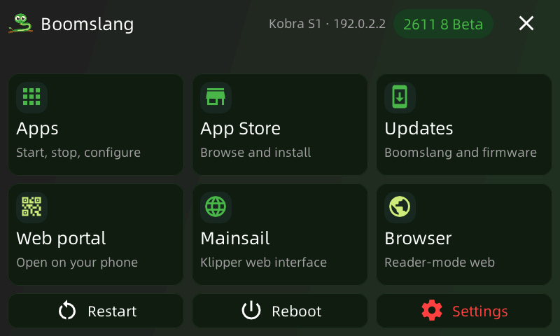
    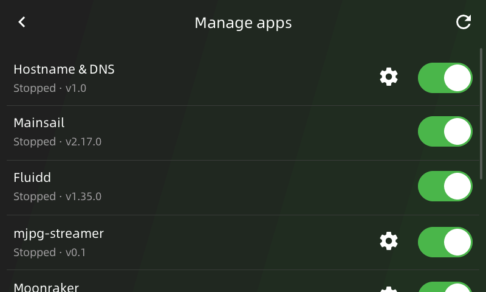
    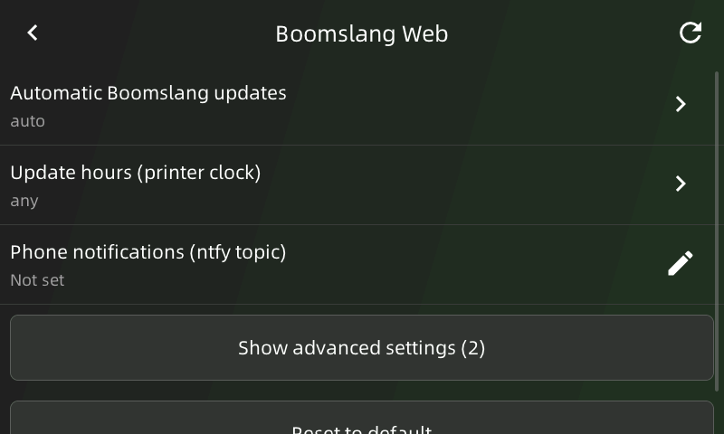

**Aero**, a taskbar and glass panes on the home screen (the other screens look Classic):

    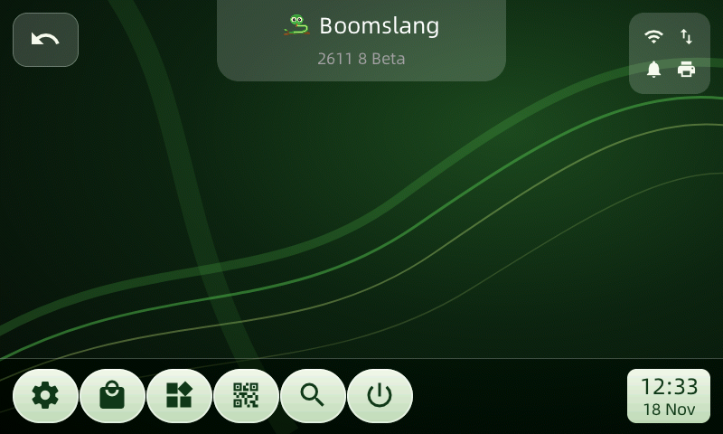

**Liquid Plastic**, clear glass on every screen, with a quick settings panel (brightness, sounds, automatic updates) that drops down from the top:

    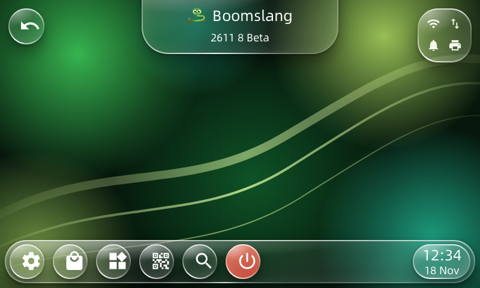
    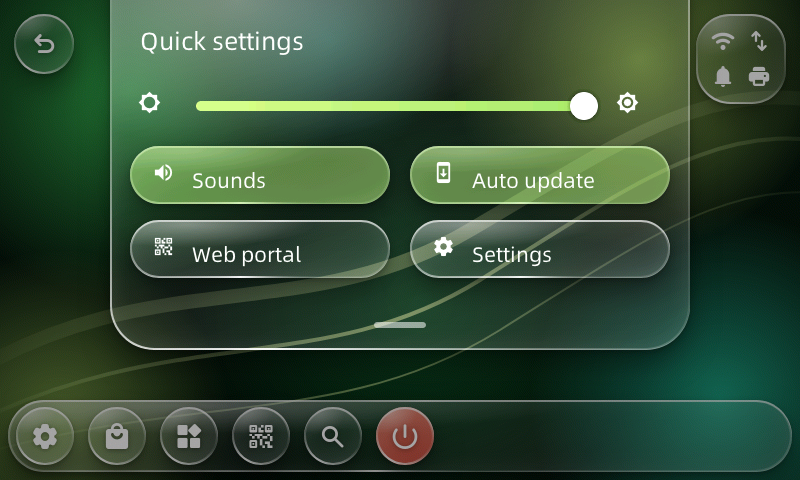
    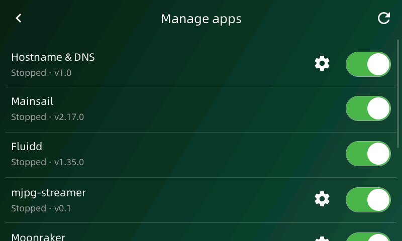

    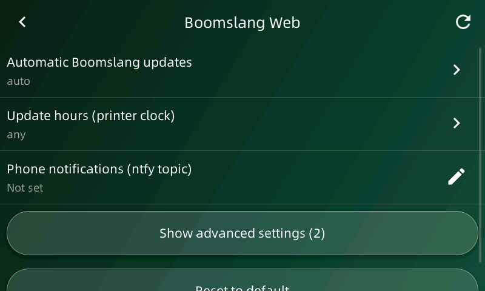
    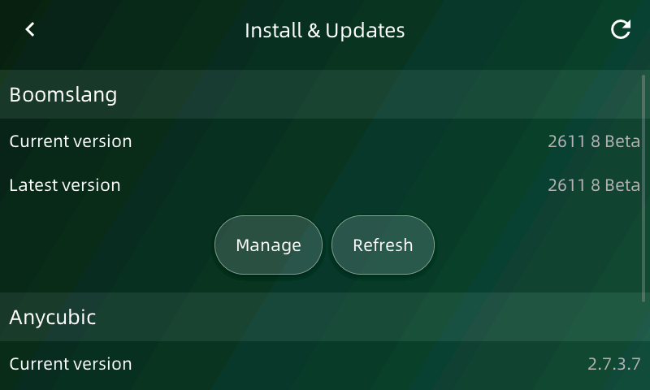
    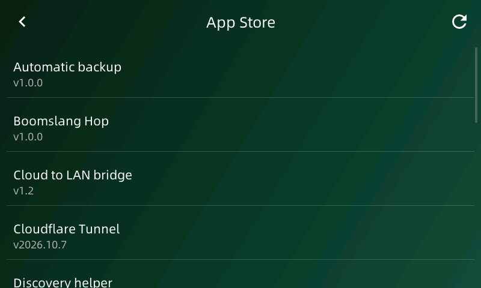

### App settings

Every app with settings has a gear in the Apps list. On/off settings are switches, numbers have − and + buttons, choices open a list and text opens a keyboard. Advanced settings are folded away, and when you change a running app, Boomslang offers to restart it so the new settings are used.

## Boomslang Installer

From the release pages, you'll find the installer-\*.swu files for your printer model. This is an interactive touch tool to install and update Boomslang and system firmware updates.

You can find more information in [the documentation](https://rinkhals-community.github.io/Rinkhals/about/rinkhals-installer/)

## Apps system

> [!WARNING]
> Those printers are quite weak in terms of CPU and Memory. Every additional app / feature and client you connect to the web interface will make the experience slower and might end up in crashes. 
> Having said that, running your printer with Moonraker, 1\~2 apps and 1\~2 connected clients should work fine.

An apps system is provided in Boomslang. It allows for the users to easily add some features to their printer. Some default ones ship with every release (Moonraker, Mainsail, Fluidd, mjpg-streamer, Remote display via VNC, Hostname/mDNS, the opt-in Firmware Collector, and the Boomslang monitor for MQTT) and additional community apps are available on separate repos like:
- https://github.com/Gubir34/Boomslang.Apps, the Boomslang app store (Print notifications, Automatic backup, Timelapse viewer, System monitor, Boomslang Hop, Quick links, Tailscale, Cloudflare Tunnel, OctoApp, OctoEverywhere, NFS mount, stunnel, and more)
- https://github.com/basvd/Rinkhals.WebUI (a web interface for Boomslang)

The default apps are listed in detail under [Features and built-in apps](https://rinkhals-community.github.io/Rinkhals/about/#features-and-built-in-apps) in the documentation. Instructions on how to install or develop apps live in the [Boomslang.Apps](https://github.com/Gubir34/Boomslang.Apps) repository.

### App Store

The Boomslang Touch UI includes a built-in **App Store** that lets you browse, install and remove community apps without leaving the printer screen. Apps are sourced directly from [Gubir34/Boomslang.Apps](https://github.com/Gubir34/Boomslang.Apps) on GitHub.

    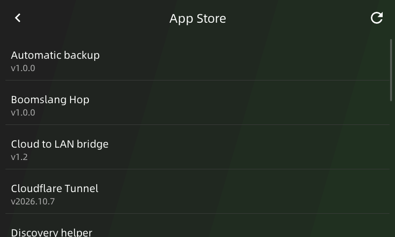
    

To use it, open the Boomslang Touch UI and tap **App Store**. The store will fetch the latest app list, show version info and flag already-installed apps. Tap any app to see its description, then tap **Install** or **Remove** as needed.

    

## Contributing

> [!NOTE]
> If you develop on Windows, don't forget to disable Git's autocrlf function, as this repo contains Linux scripts running on Linux machines. 
> Run `git config core.autocrlf false` **BEFORE** cloning the repo

### Branches and update channels

Every update channel has its own branch. A push to a channel branch builds and publishes the next release of that channel:

| Branch | Update channel | What goes there |
| -- | -- | -- |
| `alpha` | Alpha | All new work, first. Open pull requests against this branch |
| `beta` | Beta | Alpha builds where the bugs that were found have been fixed |
| `master` | Release | Beta builds that have been tested on a printer. Stable only. The default branch, so the README you read here is the stable one |

A change moves up one step at a time, by fast-forwarding the next branch to the one before it (`git checkout beta && git merge --ff-only alpha && git push`, later `git checkout master && git merge --ff-only beta && git push`). The same commit then gets its own release in the new channel. Printers only get a release when they use that channel (or a less stable one with test versions enabled).

More and more contributors help this project move faster. Thank you everyone!
If you want to help and contribute, whether it's code, documentation or sharing good ideas, the upstream Rinkhals community is on Discord!

  

Boomslang is maintained by **Gubir34**.

Boomslang is built on the work of the upstream Rinkhals maintainers: **jbatonnet**, **martinbogo**, **antirad** and **basvd**. Thank you!

Special thanks to those people for providing the base research and helping support for more printers:
- **utkabobr** (https://github.com/utkabobr/DuckPro-Kobra3)
- **systemik** (https://github.com/systemik/Kobra3-Firmware)
- **moosbewohner** for Kobra 2 Pro support. (https://github.com/moosbewohner/Rinkhals)
- **Kalenell** and **woswai1337** for Kobra S1 support.
- **evil_santa**, **CalmFrog**, **basvd**, **_René**, **RadioRadio** and more for Kobra 3 Max support.
- **AndrewS** for ethernet adapters USB testing and Kobra X firmware dump.
- **Ac_K** for passwords and technical discovery of Kobra X.
- **clutchthrower** for the built-in App Store in the Touch UI.
- Anycubic for the cool printer and the few OSS items. (https://github.com/ANYCUBIC-3D/Kobra)
